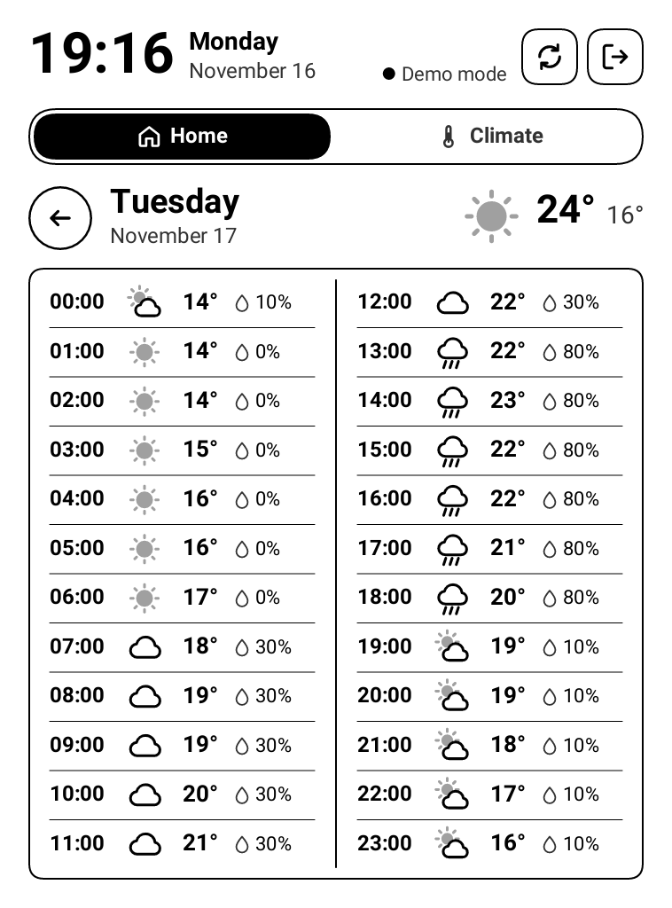

# Home Kobo Viewer

A Home Assistant control panel that runs natively on a Kobo e-reader: it draws
straight to the e-ink screen, redraws only what changed, and can sleep and wake
by itself to stay current. Built for a Kobo Aura (6", 758×1024) running Kobo
software 4.x, with a door lock and a Google TV.

<p align="center"></p>

## What is in this repository

| Path | What it is |
|---|---|
| `src/`, `deploy/`, `lang/`, `assets/` | The native Kobo dashboard and its setup tool (this page) |
| [`phone-panel/`](phone-panel/index.html) | A single-file web dashboard for phones, served by Home Assistant |
| [`docs/home-assistant/`](docs/home-assistant/README.md) | Guide: installing Home Assistant on a Windows server, adding devices, installing the phone panel |
| [`docs/upstream/`](docs/upstream/README.md) | Documentation of the project this is forked from |

## Where this comes from

This is a fork of [armamut/kobo-ha-dashboard](https://github.com/armamut/kobo-ha-dashboard)
0.3.18 (MIT, see `LICENSE.kobo-ha-dashboard`). The screen, touch, sleep,
watchdog and Wi-Fi handling and the setup tool are theirs and already proven on
real Kobos, including the Aura. Their documentation is kept in
[`docs/upstream/README.md`](docs/upstream/README.md) and still applies: device
support, troubleshooting, every configuration option.

Added here:

| Card | `type` | What it does |
|---|---|---|
| Door lock | `lock` | Shows locked / unlocked. One tap locks. Unlocking needs a second tap on the same card within 6 seconds ("Tap again to unlock"), so a stray touch on a wall panel never opens the door. An offline lock cannot be tapped. |
| TV remote | `remote` | For a `remote.*` entity such as the one the **Android TV Remote** integration creates. Arrows and OK, power, Home, Back, volume down / mute / up, previous / play-pause / next. |

| Floorplan | `floorplan` | An overhead plan of the home. Rooms are rectangles on a grid that share walls where they touch, with devices placed inside them. Tap a device to work that device; tap the room around it to turn every light, switch and fan in the room off if any is on, otherwise all on. A lit room is shaded. |

The **weather card** also gained a day page: tap any day in its forecast strip
and the page shows that day hour by hour (time, conditions, temperature,
chance of rain), with a back button. It returns to the dashboard by itself
after two minutes untouched. Hours come from the weather integration's hourly
forecast, which usually covers the next one to two days; a day beyond that, or
an integration without hourly data, shows "No hourly forecast for this day".

<p align="center"></p>

The lock and remote cards are created automatically for `lock.*` and
`remote.*` entities when the setup tool generates a starter dashboard, and all
three are in its card list.

<p align="center"></p>

### Drawing the floorplan

In the setup tool's **Design** step, add a *Floorplan* card and open it:

- Drag **+ Room** onto the plan (or click it). Drag a room to move it and drag
  its bottom-right corner to resize it. Rooms snap to the grid, so placing two
  side by side makes them share a wall. Click a room to rename or remove it.
- Drag a device from the list on the left onto the plan, and drag it again to
  move it. The search box narrows the list. Click a device to change its icon
  or remove it. A device belongs to whichever room it sits in.
- *Plan width* and *Plan height* set the size of the grid in squares.

The preview on the right shows the plan as the Kobo will draw it.

What a tap does on the Kobo:

| Tapped | Result |
|---|---|
| Light, switch, fan, TV | Toggles it |
| Lock | Locks at once; unlocking needs a second tap within 6 seconds |
| Scene, script, button | Runs it |
| Temperature or other sensor | Shown as a reading; not tappable |
| Room | Switches its lights, switches and fans together. Never locks, TVs or heating |

## Updates over Wi-Fi

After one USB install, the Kobo can receive everything else without a cable:
layout changes (pages, cards, the floorplan) and new versions of the
dashboard program itself. There are two ways to send them; the first is the
default and needs nothing set up in Home Assistant.

### Straight from the computer (default)

The setup tool runs a small update server and the Kobo downloads from it.

```
Kobo  ◀──── downloads over Wi-Fi ────  setup tool on the PC (port 3001)
```

**One-time setup**

1. In the setup tool's **Install** step, under *Send over Wi-Fi*, leave *How to
   send* on **Straight from this computer** and click **Send over Wi-Fi**. If
   Windows asks whether to allow the program on the network, allow it on
   private networks. The first time, this creates an update key.
2. Install by USB once more, so the Kobo receives the key and this computer's
   address.
3. In your router, give this computer a fixed address (DHCP reservation). The
   Kobo looks for updates at that address; if it changes, send again and
   install by USB once more.

**From then on**: change anything in the setup tool and click **Send over
Wi-Fi**, then keep the window open. The Kobo checks every five minutes while
the dashboard is open, and immediately when you tap its refresh button; the
page says "The Kobo has taken the update" when it has. For a new version of
the app, download the new package, copy your `config.yaml` into its folder,
run its setup tool and click the same button.

The update server is a separate listener that hands out the signed bundle and
nothing else. The setup page itself, which handles your Home Assistant token,
stays reachable only from the computer it runs on.

### Through a Home Assistant folder

Choose **Through a Home Assistant folder** if you would rather not keep the
setup tool open: the bundle is written into a folder Home Assistant serves,
and the Kobo downloads it from there whenever it next looks.

1. In Home Assistant, install the **Samba share** add-on so the PC can reach
   the `config` folder. Create a `www` folder inside it if there is none and
   restart Home Assistant once (it only starts serving `www` at boot).
2. Check the folder the setup tool suggests
   (`\\<home-assistant>\config\www\kobo-ha`; open that address in File
   Explorer once so Windows signs in to the share) and click **Send over
   Wi-Fi**.
3. Install by USB once more.

Home Assistant serves that folder without a login, so anyone on your network
can read the published layout (page names, entity ids), though never the
token or the key. File sharing from a Windows PC to a Home Assistant virtual
machine running on that same PC is unreliable; use the first way there.

**What keeps it safe**

- Neither route asks the Kobo to log in, so the published layout carries no
  secrets: the Home Assistant token and the update key are removed, and the
  Kobo keeps its own.
- Every bundle is signed with the update key, which only the PC and the Kobo
  hold. The Kobo ignores a bundle whose signature is wrong, any file that
  does not match its signed hash, anything older than what it already has,
  and any file name outside the four it expects.
- A new program is only staged. The launcher checks that it runs before
  switching to it, keeps the previous one, and puts the previous one back if
  the new one stops within a minute of starting. A program that was rolled
  back is not downloaded again.

Still done by USB: the very first install, NickelMenu itself (and
reinstalling it after a Kobo software update), and the name of the menu entry.

## What has been done so far

1. Imported kobo-ha-dashboard 0.3.18 as the base (native e-ink drawing,
   partial refresh, touch, sleep, setup tool).
2. Added the **door lock** card with its two-tap unlock.
3. Added the **TV remote** card for Android TV / Google TV.
4. Added the **floorplan** card and its drag-and-drop editor in the setup tool.
5. Added **updates over Wi-Fi** for the layout and the program, signed, with
   automatic rollback of a program that fails to start.
6. Added the **hour-by-hour weather page**, opened by tapping a forecast day.
7. Translated the new text into all eleven languages the app ships with.
8. Added automated tests for every addition (89 tests in total pass).
9. Set the build to publish the Kobo program and the Windows and Linux setup
   tools as a release on every push to `main`.
10. Brought the phone web panel and the Home Assistant setup guide into this
   repository, so everything is in one place.

### Confirmed on a real Kobo Aura (v0.5.2, 16 November 2026)

- Installing by USB from the Windows setup tool, and starting the dashboard
  from the Kobo's menu.
- Receiving an update over Wi-Fi straight from the setup tool.
- Turning a TV on and off, the weather card, and the floorplan showing.

### Not yet verified

- On the Kobo: the door lock card and its two-tap unlock, the TV remote's
  arrow, volume and playback keys, tapping rooms and devices on the
  floorplan, and the hour-by-hour weather page. These were tested on a
  computer with simulated devices.
- A Kobo on Wi-Fi updates needs the 0.5.2 program or later: earlier versions
  only look in the Home Assistant folder, so the first move to 0.5.2 is by USB.
- Updates over Wi-Fi were tested on a computer: a real download over HTTP from
  the setup tool's update server, the signature and hash checks, and the
  launcher's swap and rollback run with stand-in programs. They have not been
  tried on a Kobo, on the Kobo's own shell, or across a real home network.
  Publishing through a Home Assistant folder could not be completed on the
  one real setup it was tried on (Windows could not open the Samba share of a
  Home Assistant VM hosted on the same PC), which is why sending straight
  from the computer is the default.

## Install (Windows PC + Kobo)

1. On this repository's page on GitHub, open **Releases** (right-hand side),
   pick the newest one, download `kobo-ha-dashboard-<version>-windows-x64.zip`
   under *Assets* and unzip it.
2. Run `kobo-ha-dashboard.exe`. A page opens at `http://localhost:3000`.
   Windows may warn that the program is unsigned: choose *More info → Run anyway*.
3. **Connect**: enter Home Assistant's address by IP, for example
   `http://192.168.1.50:8123` (the Kobo cannot resolve `homeassistant.local`),
   and a long-lived access token (Home Assistant → your name → Security →
   Long-lived access tokens → Create token).
4. **Design**: pick *Kobo Aura* as the device, then arrange pages and cards.
   Add a *Door lock* card for the lock and a *TV remote* card for the TV's
   `remote.…` entity.
5. **Install**: plug the Kobo in by USB, tap *Connect* on the Kobo, and click
   *Install NickelMenu and dashboard*. Eject the Kobo; it restarts once.
6. On the Kobo, open the menu at the bottom right and choose **Home Dashboard**.
   The exit icon at the top right returns to reading.

The Kobo must be on a Wi-Fi network that can reach Home Assistant. A Kobo
software update removes NickelMenu; run step 5 again afterwards.

## Configuration by hand

The setup tool writes `.kobo-ha/config.yaml` on the Kobo. The new cards look
like this (see `config.example.yaml` for everything else):

```yaml
- type: "lock"
  entity_id: "lock.front_door"
  title: "Front door"

- type: "remote"
  entity_id: "remote.living_room_tv"
  title: "Living room TV"
```

## Building

```
cargo test                 # unit tests
cargo run                  # setup tool on this computer
cargo run -- --simulator   # interactive preview with demo data
./deploy/build-kobo.sh     # ARMv7 build for the Kobo
```

Every push to `main` runs `.github/workflows/release.yml`, which builds the
Kobo program and the Windows and Linux setup tools and publishes them as the
release for the version in `Cargo.toml` (`v0.5.2`, ...). Raise that version to
get a new release; pushes without a version change refresh the files of the
existing one.

## Licence

The imported code is MIT-licensed by armamut (`LICENSE.kobo-ha-dashboard`);
that notice must stay with any copy. Not affiliated with Rakuten Kobo or Home
Assistant.
