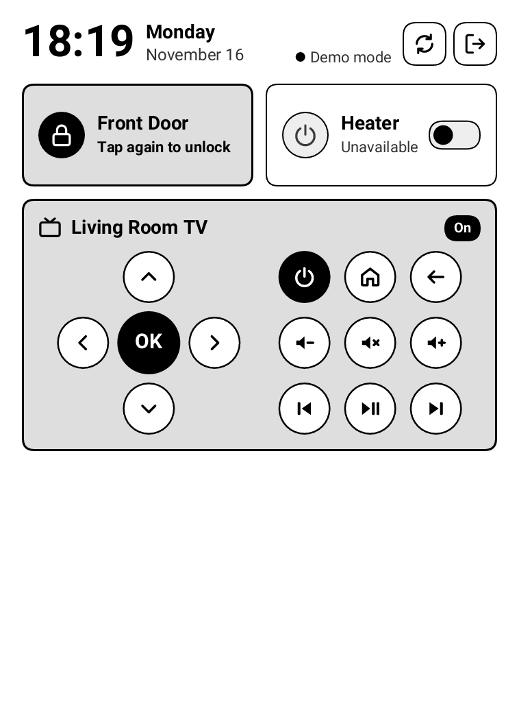
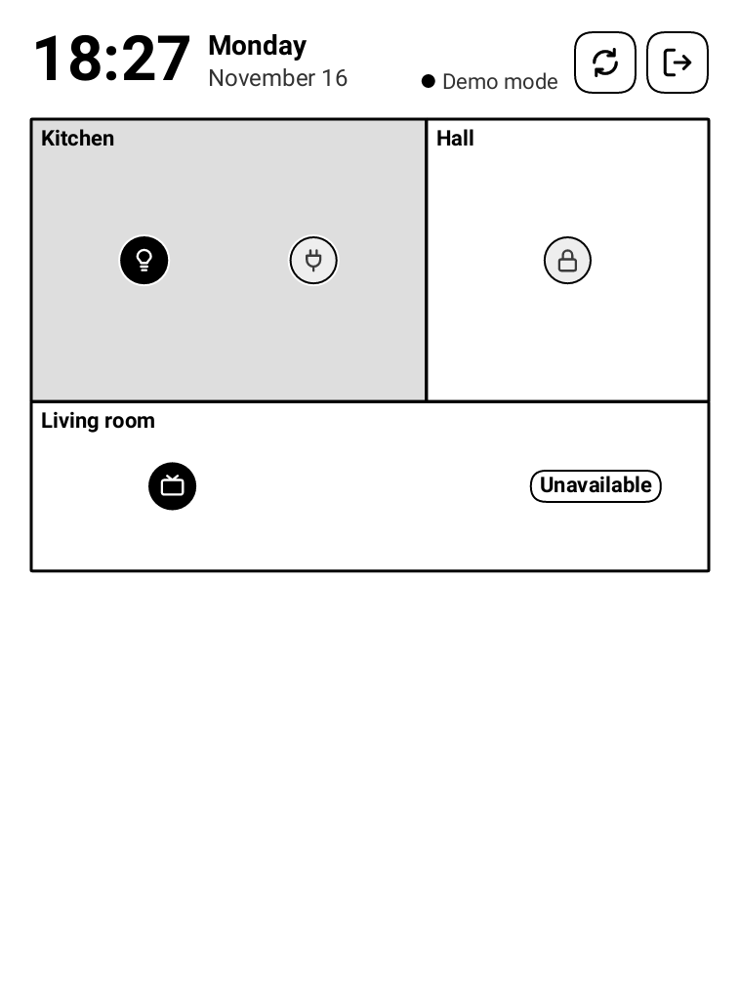

# Home Kobo Viewer

A Home Assistant control panel that runs natively on a Kobo e-reader: it draws
straight to the e-ink screen, redraws only what changed, and can sleep and wake
by itself to stay current. Built for a Kobo Aura (6", 758×1024) running Kobo
software 4.x, with a door lock and a Google TV.

<p align="center"></p>

## Where this comes from

This is a fork of [armamut/kobo-ha-dashboard](https://github.com/armamut/kobo-ha-dashboard)
0.3.18 (MIT, see `LICENSE.kobo-ha-dashboard`). The screen, touch, sleep,
watchdog and Wi-Fi handling and the setup tool are theirs and already proven on
real Kobos, including the Aura. Their documentation is kept in
[`docs/upstream/README.md`](docs/upstream/README.md) and still applies: device
support, troubleshooting, every configuration option.

Added here:

| Card | `type` | What it does |
|---|---|---|
| Door lock | `lock` | Shows locked / unlocked. One tap locks. Unlocking needs a second tap on the same card within 6 seconds ("Tap again to unlock"), so a stray touch on a wall panel never opens the door. An offline lock cannot be tapped. |
| TV remote | `remote` | For a `remote.*` entity such as the one the **Android TV Remote** integration creates. Arrows and OK, power, Home, Back, volume down / mute / up, previous / play-pause / next. |

| Floorplan | `floorplan` | An overhead plan of the home. Rooms are rectangles on a grid that share walls where they touch, with devices placed inside them. Tap a device to work that device; tap the room around it to turn every light, switch and fan in the room off if any is on, otherwise all on. A lit room is shaded. |

The lock and remote cards are created automatically for `lock.*` and
`remote.*` entities when the setup tool generates a starter dashboard, and all
three are in its card list.

<p align="center"></p>

### Drawing the floorplan

In the setup tool's **Design** step, add a *Floorplan* card and open it:

- Drag **+ Room** onto the plan (or click it). Drag a room to move it and drag
  its bottom-right corner to resize it. Rooms snap to the grid, so placing two
  side by side makes them share a wall. Click a room to rename or remove it.
- Drag a device from the list on the left onto the plan, and drag it again to
  move it. The search box narrows the list. Click a device to change its icon
  or remove it. A device belongs to whichever room it sits in.
- *Plan width* and *Plan height* set the size of the grid in squares.

The preview on the right shows the plan as the Kobo will draw it.

What a tap does on the Kobo:

| Tapped | Result |
|---|---|
| Light, switch, fan, TV | Toggles it |
| Lock | Locks at once; unlocking needs a second tap within 6 seconds |
| Scene, script, button | Runs it |
| Temperature or other sensor | Shown as a reading; not tappable |
| Room | Switches its lights, switches and fans together. Never locks, TVs or heating |

## What has been done so far

1. Imported kobo-ha-dashboard 0.3.18 as the base (native e-ink drawing,
   partial refresh, touch, sleep, setup tool).
2. Added the **door lock** card with its two-tap unlock.
3. Added the **TV remote** card for Android TV / Google TV.
4. Added the **floorplan** card and its drag-and-drop editor in the setup tool.
5. Translated the new text into all eleven languages the app ships with.
6. Added automated tests for each new card (81 tests in total pass).
7. Set the build to produce the Kobo program and the Windows and Linux setup
   tools on every push to the `kobo-dashboard` branch.

### Not yet verified

- Nothing here has run on a physical Kobo. The new cards were rendered and
  tested at Kobo Aura size on a computer, and the floorplan editor was tested
  in a desktop browser.
- The lock, remote and floorplan cards have not been used against a real Home
  Assistant; they were tested with simulated devices.

## Install (Windows PC + Kobo)

1. Download `kobo-ha-dashboard-<version>-windows-x64.zip` from this
   repository's **Releases** page and unzip it.
2. Run `kobo-ha-dashboard.exe`. A page opens at `http://localhost:3000`.
   Windows may warn that the program is unsigned: choose *More info → Run anyway*.
3. **Connect**: enter Home Assistant's address by IP, for example
   `http://192.168.1.50:8123` (the Kobo cannot resolve `homeassistant.local`),
   and a long-lived access token (Home Assistant → your name → Security →
   Long-lived access tokens → Create token).
4. **Design**: pick *Kobo Aura* as the device, then arrange pages and cards.
   Add a *Door lock* card for the lock and a *TV remote* card for the TV's
   `remote.…` entity.
5. **Install**: plug the Kobo in by USB, tap *Connect* on the Kobo, and click
   *Install NickelMenu and dashboard*. Eject the Kobo; it restarts once.
6. On the Kobo, open the menu at the bottom right and choose **Home Dashboard**.
   The exit icon at the top right returns to reading.

The Kobo must be on a Wi-Fi network that can reach Home Assistant. A Kobo
software update removes NickelMenu; run step 5 again afterwards.

## Configuration by hand

The setup tool writes `.kobo-ha/config.yaml` on the Kobo. The new cards look
like this (see `config.example.yaml` for everything else):

```yaml
- type: "lock"
  entity_id: "lock.front_door"
  title: "Front door"

- type: "remote"
  entity_id: "remote.living_room_tv"
  title: "Living room TV"
```

## Building

```
cargo test                 # unit tests
cargo run                  # setup tool on this computer
cargo run -- --simulator   # interactive preview with demo data
./deploy/build-kobo.sh     # ARMv7 build for the Kobo
```

Pushing a tag such as `v0.4.0` runs `.github/workflows/release.yml`, which
builds the Kobo program and the Windows and Linux setup tools and publishes
them as a release.

## Licence

The imported code is MIT-licensed by armamut (`LICENSE.kobo-ha-dashboard`);
that notice must stay with any copy. Not affiliated with Rakuten Kobo or Home
Assistant.
